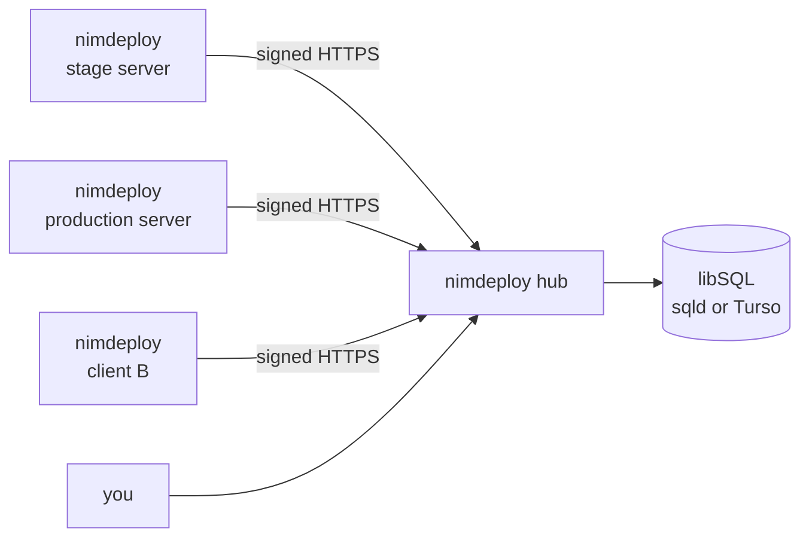

# Central hub

Each nimdeploy runs on its own server. The **hub** gathers them: every
server (an *agent*) sends what happens to it, and the hub shows all clients,
environments and servers in one dashboard, with an API and Prometheus
metrics on top.



- It is the same binary: `nimdeploy hub serve`.
- Agents only make **outgoing** requests: the hub never connects to your
  servers and needs no access to them.
- Each agent has its own token. Requests are signed (HMAC-SHA256 over a
  timestamp and the body) and older than 5 minutes are refused. Revoking one
  agent doesn't touch the others.
- If the hub is down, events wait on the agent's disk (`.hub-outbox` in the
  log directory, up to 5000) and are sent when it's back. Deploys never wait
  for the hub.
- Data lives in [libSQL](https://github.com/tursodatabase/libsql) (SQLite as
  a server): `sqld` next to the hub, or a Turso database.

What agents send:

| Event | When | Contains |
|---|---|---|
| `deploy.started` | a run starts | state: trigger, commit, pusher, labels |
| `deploy.finished` | a run ends | state, duration, error, and on failure the last log lines (`send_log_tail`) |
| `deploy.rejected` | a request was refused (bad signature, wrong repository…) | reason |
| `command.refused` | the agent refused a [command](#commands-from-the-hub) | reason |
| heartbeat | every minute | version, uptime, deploys with their config (provider, repository, branch, schedule, labels) and state, events waiting |

A finished run also carries the commit message's first line, the time of each
phase (queue, CI wait, hooks, command) and, for [Ansible](ansible.md), the
outcome per host.

The full log, `params`, the request body and secrets are never sent.

## Run the hub with Docker Compose

```bash
mkdir nimdeploy-hub && cd nimdeploy-hub
curl -fsSLO https://raw.githubusercontent.com/aitorroma/nimdeploy/main/deploy/hub/docker-compose.yml
curl -fsSL https://raw.githubusercontent.com/aitorroma/nimdeploy/main/deploy/hub/.env.example -o .env
sed -i "s/^NIMDEPLOY_HUB_TOKEN=.*/NIMDEPLOY_HUB_TOKEN=$(openssl rand -hex 32)/" .env
docker compose up -d
```

It starts `sqld` (only on an internal network, data in the `sqld-data`
volume) and the hub on `127.0.0.1:9100`. Publish it over HTTPS with your
reverse proxy, e.g. nginx:

```nginx
server {
    server_name hub.example.com;
    # listen 443 ssl; certificates...
    location / {
        proxy_pass http://127.0.0.1:9100;
        proxy_set_header Host $host;
        proxy_set_header X-Forwarded-Proto $scheme;
        proxy_set_header X-Forwarded-For $remote_addr;
    }
}
```

The dashboard asks for the `NIMDEPLOY_HUB_TOKEN`. Behind Cloudflare Access
(or another authenticating proxy) you can let its header in instead:
`NIMDEPLOY_HUB_TRUSTED_HEADER=Cf-Access-Authenticated-User-Email`. Do that
only if the proxy is the only way to reach the hub, since anyone who can
reach it directly could send that header. Leave `/api/v1/events` reachable
by the agents (in Cloudflare Access, a bypass rule for that path; the
agents authenticate with their own signature).

## Run the hub on Kubernetes (Helm)

```bash
helm install hub oci://ghcr.io/aitorroma/charts/nimdeploy-hub -n nimdeploy --create-namespace \
  --set ingress.enabled=true --set ingress.host=hub.example.com \
  --set ingress.className=nginx --set 'ingress.tls[0].secretName=hub-tls' \
  --set 'ingress.tls[0].hosts[0]=hub.example.com'

# dashboard token (generated on install, kept on upgrades)
kubectl -n nimdeploy get secret hub-nimdeploy-hub -o jsonpath='{.data.token}' | base64 -d; echo
```

The chart runs the hub (a Deployment, non-root, read-only filesystem) and
`sqld` (a StatefulSet with a 2 Gi volume, reachable only from the hub through
a NetworkPolicy). Main values:

| Value | Default | |
|---|---|---|
| `hub.token` / `hub.existingSecret` | generated | dashboard and API token (Secret key `token`) |
| `hub.trustedHeader` | – | header from an authenticating proxy |
| `hub.retainDays` | `90` | events older than this are deleted (the current state stays) |
| `sqld.enabled` | `true` | `false` with `externalDatabase.url` (and `token`) for Turso |
| `sqld.persistence.size` | `2Gi` | |
| `ingress.*` | disabled | |
| `serviceMonitor.enabled` | `false` | scrape `/metrics` with the Prometheus Operator |
| `hub.logFormat` | `text` | or `json` |
| `hub.tls.existingSecret` | – | a `kubernetes.io/tls` Secret: the hub serves HTTPS itself |
| `hub.tls.clientCASecret` | – | Secret with `ca.crt`: the agents' CA (mTLS) |
| `hub.tls.agentCerts` | `optional` | or `require` |
| `hub.tls.certificate.enabled` | `false` | cert-manager issues the hub's certificate (`issuerRef`, default ClusterIssuer `letsencrypt-prod`) |
| `hub.agentCA.enabled` | `false` | the hub's own CA for [agent certificates](#agent-certificates), in a small volume (or `hub.agentCA.existingSecret`) |
| `ingressRouteTCP.enabled` | `false` | Traefik route with TLS passthrough (`ingressRouteTCP.host`); plain HTTP redirects to HTTPS (`redirectHTTP`) |

For client certificates the hub must see the TLS handshake: expose it with
TLS passthrough or `service.type: LoadBalancer`, not with an Ingress that
terminates TLS. With Traefik (k3s) and cert-manager:

```bash
helm upgrade --install hub oci://ghcr.io/aitorroma/charts/nimdeploy-hub -n nimdeploy --create-namespace \
  --set hub.tls.certificate.enabled=true --set hub.agentCA.enabled=true \
  --set ingressRouteTCP.enabled=true --set ingressRouteTCP.host=hub.example.com
```

## Connect a server

In the dashboard, **Add agent**: pick the client (or type a new one) and the
environment; the agent's name is filled in from them. The hub creates the
agent and shows, once, its token and what to add on the server, then waits
for its first heartbeat and tells you when it arrives.

From a shell it is the same, and the token is printed once:

```bash
docker compose exec hub nimdeploy hub agent add acme-stage
# Kubernetes: kubectl -n nimdeploy exec deploy/hub-nimdeploy-hub -- nimdeploy hub agent add acme-stage
```

On the server, add it to the config, and the token to `secrets.env`:

```toml title="config.toml"
[labels]
client = "Acme"
environment = "stage"

[hub]
url = "https://hub.example.com"
agent = "acme-stage"           # default: the short hostname
token_env = "NIMDEPLOY_HUB_TOKEN"
# send_log_tail = 20               # log lines sent with a failed deploy (0-500)
# heartbeat = "1m"
```

```bash title="secrets.env"
NIMDEPLOY_HUB_TOKEN=…
```

Restart nimdeploy (`systemctl restart nimdeploy`). The server appears in
**Agents** within seconds, with its deploys, even those that never ran. Set
[labels](labels.md) on every server: the dashboard groups by `client` and
`environment`.

An agent that misses three heartbeats shows as **offline**, and its deploys
are faded in the dashboard (their state may be old). A deploy removed from
the config shows as *removed* until its events expire.

## Dashboard

The sidebar lists clients (from the `client` label) and their environments,
with a dot per deploy colored by its last result. ⌘K / Ctrl+K filters it.

- **Overview**: deploys and failures this week, success rate, servers online,
  deploys per day, a client × environment matrix, what needs attention and
  the latest activity. Filter it by environment.
- **Client / environment**: its deploys with their last runs, schedule and
  who triggered them, and the server they run on.
- **Deploy**: last run, commit and message, source, the error, the phases of
  the run on a timeline, the hosts of an Ansible run, the log tail, the
  history of runs and, when the agent accepts them, [commands](#commands-from-the-hub).
- **Activity** (last 24 hours) and **Needs attention**: failed deploys,
  servers offline or with events waiting, agents that never connected,
  certificates about to expire.
- **Agents**: heartbeats of the last 30 minutes, host, version, uptime,
  certificate and commands; add agents, give them a new token or revoke them.

Pages refresh on their own every 20 seconds. The dashboard is in English and
Spanish: it follows the browser's language, and the switch at the bottom of
the sidebar remembers your choice. Light and dark themes follow the system.

## Agent certificates

With `-agent-ca-dir` the hub keeps its own small CA and issues a client
certificate per agent: tick **Require a client certificate** when adding the
agent (or giving it a new token). The drawer gives you the certificate and its
key to download, once; copy them to the server and point `cert_file` and
`key_file` at them. The certificate is valid for a year and carries the
agent's name; the hub pins its fingerprint, so another agent's certificate,
or an old one after a new token, is refused. Agents whose certificate expires
within 30 days show under **Needs attention**.

```bash
nimdeploy hub serve -tls-cert hub.pem -tls-key hub.key -agent-ca-dir /var/lib/nimdeploy-hub/ca
```

- The hub must terminate TLS itself (`-tls-cert`), to see the certificate.
- The directory is created with `ca.pem` and `ca.key` (mode 0600) when it is
  empty. Back it up: if it's lost, the hub creates a new CA and every agent
  with a certificate needs a new one.
- The agent's token still signs every request; the certificate is a second
  factor tied to the server.
- `-tls-client-ca` (your own CA) still works alongside it.

## Commands from the hub

From a deploy's page you can **Run again** (the last commit) or **Roll back**
(to the previous successful commit). The agent must opt in:

```toml title="config.toml"
[hub]
accept_commands = true
```

- The hub never connects to the server: the agent asks for commands with a
  signed long poll (`GET /api/v1/commands`) and checks the hub's signature on
  the answer.
- A command runs as a normal deploy with trigger `hub`, through the same
  queue, hooks and notifications, and shows in the deploy's history with who
  asked for it.
- Commands not picked up in 10 minutes expire. The agent refuses unknown
  deploys, and a rollback without a previous successful commit or outside
  git, and the reason shows on the deploy's page.
- Every action in the dashboard needs the session's CSRF token; the hub's
  Content-Security-Policy only allows its own scripts.

## API and metrics

With `Authorization: Bearer <NIMDEPLOY_HUB_TOKEN>`:

| Endpoint | |
|---|---|
| `GET /api/v1/deploys?label=client=Acme&agent=…` | every deploy and its state |
| `GET /api/v1/agents` | agents (without tokens) |
| `GET /api/v1/events?agent=&deploy=&type=&limit=` | events, newest first (up to 1000) |
| `POST /api/v1/agents` `{"name":"…"}` | create an agent or give it a new token; returns it |
| `DELETE /api/v1/agents/{name}` | revoke |
| `GET /metrics` | Prometheus |
| `GET /healthz` | no token; checks the database too |

Creating and revoking agents only accepts the Bearer token, never the
browser session or the proxy header.

| Metric | |
|---|---|
| `nimdeploy_hub_agent_up{agent,version}` | 1 while heartbeats arrive |
| `nimdeploy_hub_agent_last_seen_timestamp_seconds{agent}` | |
| `nimdeploy_hub_agent_outbox_events{agent}` | events waiting on the agent: the hub isn't reachable from there |
| `nimdeploy_hub_deploy_info{agent,deploy,<labels>}` | 1 |
| `nimdeploy_hub_deploy_status{agent,deploy,status}` | 1 for the current status |
| `nimdeploy_hub_deploy_last_finished_timestamp_seconds{agent,deploy}` | |

```yaml title="alerts.yml"
- alert: NimdeployAgentDown
  expr: nimdeploy_hub_agent_up == 0
  for: 10m
- alert: NimdeployProductionDeployFailed
  expr: nimdeploy_hub_deploy_status{status="failed"} == 1
        and on (agent, deploy) nimdeploy_hub_deploy_info{environment="production"}
```

## Command line

```text
nimdeploy hub serve [-listen ADDR] [-database URL] [-trusted-header H] [-retain-days N]
                    [-tls-cert F -tls-key F] [-tls-client-ca F] [-agent-ca-dir DIR] [-no-auth]
nimdeploy hub agent add|list|revoke [name]
nimdeploy hub healthcheck
```

| Variable | |
|---|---|
| `NIMDEPLOY_HUB_DATABASE_URL` | `http://sqld:8080`, or `libsql://<db>-<org>.turso.io` |
| `LIBSQL_AUTH_TOKEN` | database token (Turso, or sqld with JWT auth) |
| `NIMDEPLOY_HUB_TOKEN` | dashboard and API token, at least 16 characters |
| `NIMDEPLOY_HUB_LISTEN` | default `127.0.0.1:9100` (`0.0.0.0:9100` in the image) |
| `NIMDEPLOY_HUB_TRUSTED_HEADER` | |
| `NIMDEPLOY_HUB_RETAIN_DAYS` | default `90`; `0` keeps every event |
| `NIMDEPLOY_HUB_LOG_FORMAT` | `text` or `json` |
| `NIMDEPLOY_HUB_TLS_CERT`, `NIMDEPLOY_HUB_TLS_KEY` | serve HTTPS ([details](tls.md#hub-and-agents)) |
| `NIMDEPLOY_HUB_TLS_CLIENT_CA` | CA of the agents' certificates |
| `NIMDEPLOY_HUB_AGENT_CERTS` | `optional` (default) or `require`: each agent's certificate must carry its name |
| `NIMDEPLOY_HUB_AGENT_CA_DIR` | the hub's CA for [agent certificates](#agent-certificates) |

Without a token or a trusted header, the hub only starts on a loopback
address (or with `-no-auth`).

## Backups

Everything is in sqld's data volume. Stop sqld for a few seconds and copy
it. Meanwhile the agents keep their events in their outbox and send them
afterwards:

```bash
docker compose stop sqld
docker run --rm -v nimdeploy-hub_sqld-data:/data:ro -v "$PWD":/backup alpine \
  tar czf /backup/hub-$(date +%F).tgz -C /data .
docker compose start sqld
```

On Kubernetes, use your volume snapshots (or Velero) for the sqld PVC.
Back up the agent CA too (`-agent-ca-dir`, or the `<release>-ca` PVC), once:
it doesn't change.

Losing the data isn't serious. With the next heartbeat the agents send their
inventory again. You only lose the event history and the agents' tokens, and
you just create the agents again.
